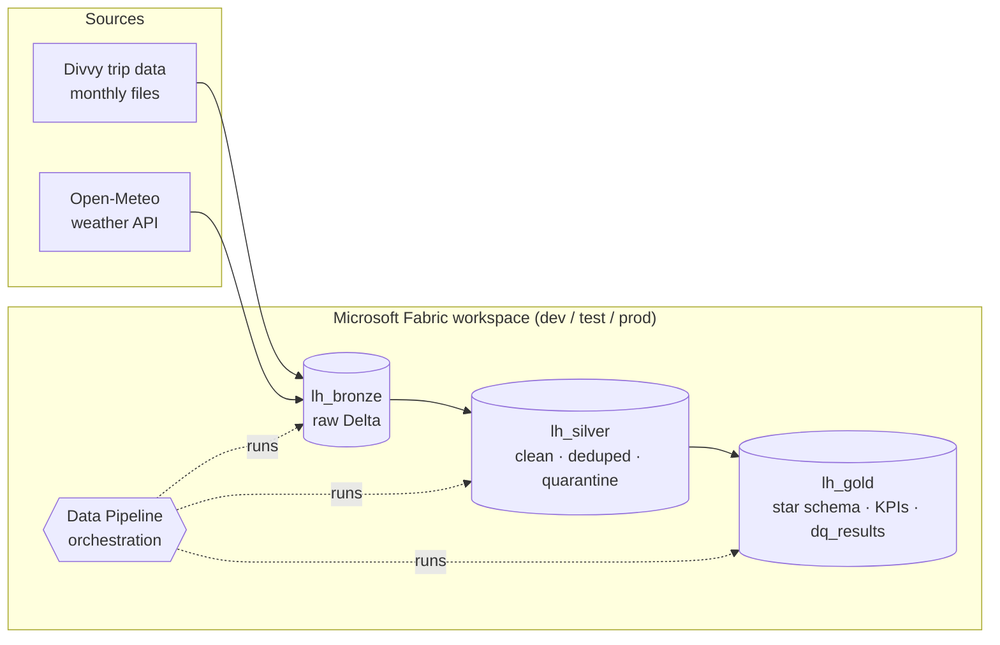
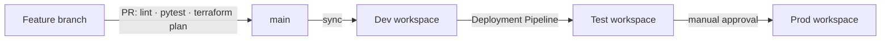

# Fabric Medallion Lakehouse — Terraform · CI/CD · Data Quality

> 🚧 **Work in progress** — see [docs/PLAN.md](docs/PLAN.md) for live progress.

Production-grade data engineering project on **Microsoft Fabric**: a bronze / silver / gold lakehouse built on
real Chicago **Divvy** bike-share trips enriched with **Open-Meteo** weather, provisioned with **Terraform**,
promoted Dev → Test → Prod through **GitHub Actions** and **Fabric Deployment Pipelines**, and guarded by
**PySpark unit tests** and **data-quality checks**.

## Architecture





## Tech stack

| Area | Tools |
|------|-------|
| Platform | Microsoft Fabric (Lakehouse, Notebooks, Data Pipelines, Environments) |
| Processing | PySpark 3.5 / Delta Lake |
| Infrastructure as Code | Terraform (`microsoft/fabric` provider), HCP Terraform remote state |
| CI/CD | GitHub Actions (OIDC, no secrets), Fabric Git integration, Fabric Deployment Pipelines |
| Testing | pytest, chispa, rules-based data-quality framework |

## Repository layout

```
.github/workflows/   CI (lint, tests, terraform plan) and CD (deploy Dev → Test → Prod)
infra/terraform/     Workspaces, lakehouses, environments, role assignments, deployment pipeline
fabric/              Fabric items synced through Git integration
src/divvy_medallion/ PySpark transformations and data-quality rules (built as a wheel)
tests/               Unit tests and data-quality tests
docs/                Plan, architecture and screenshots
```

## License

[MIT](LICENSE)
