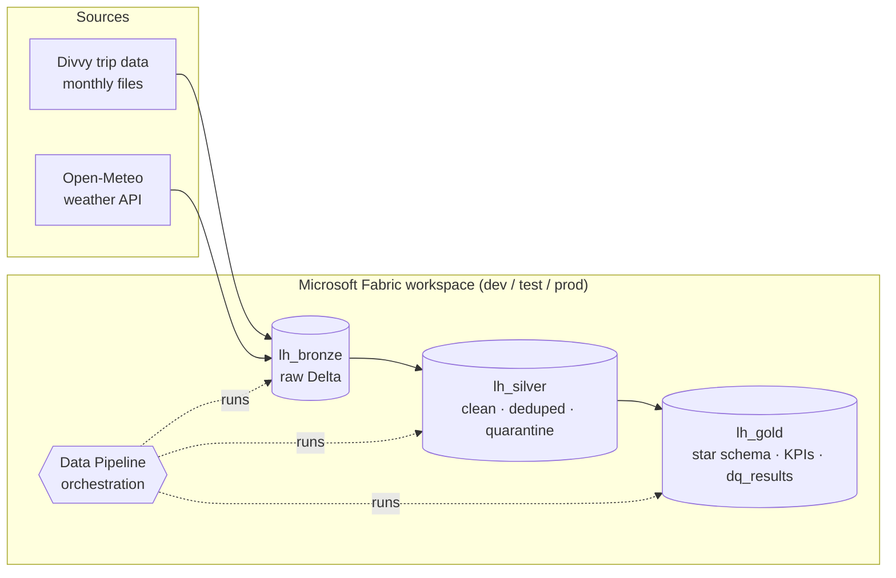
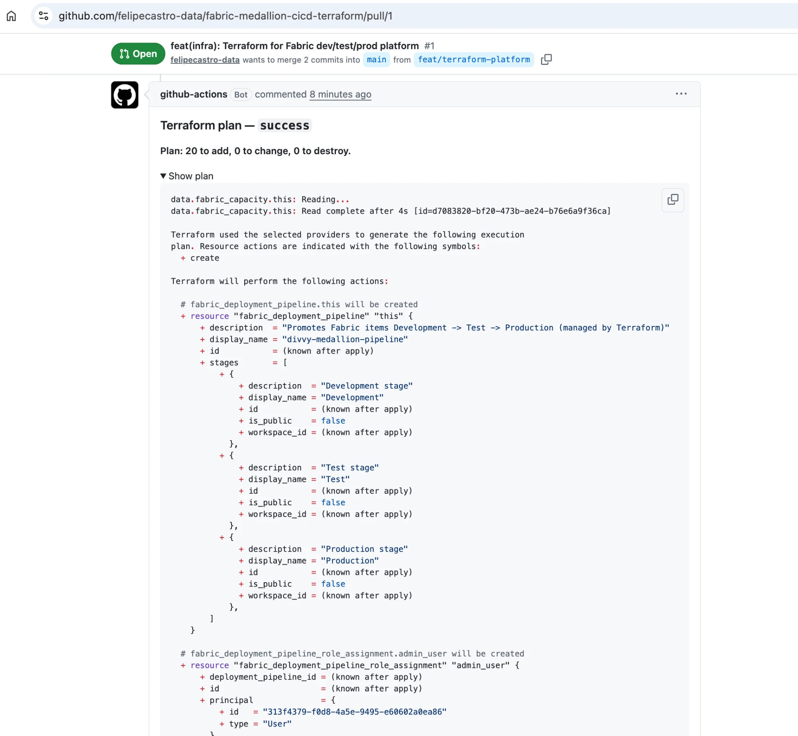
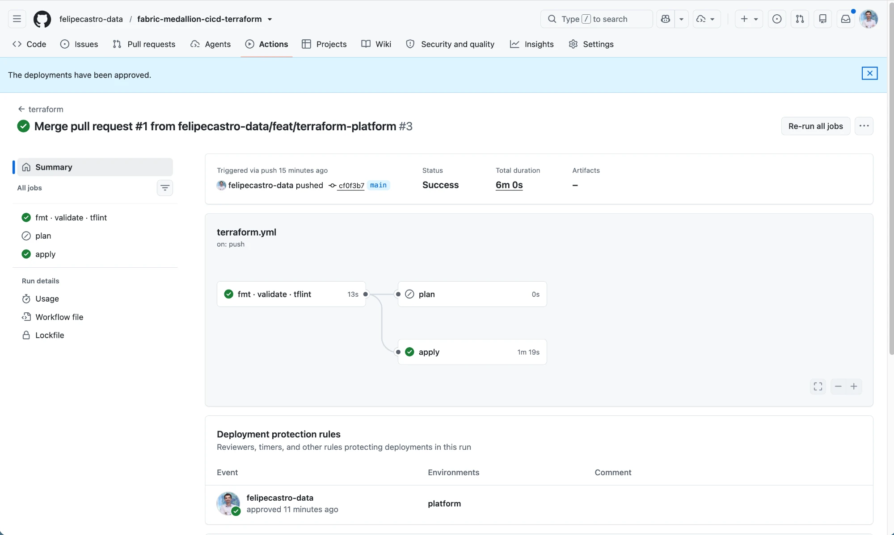
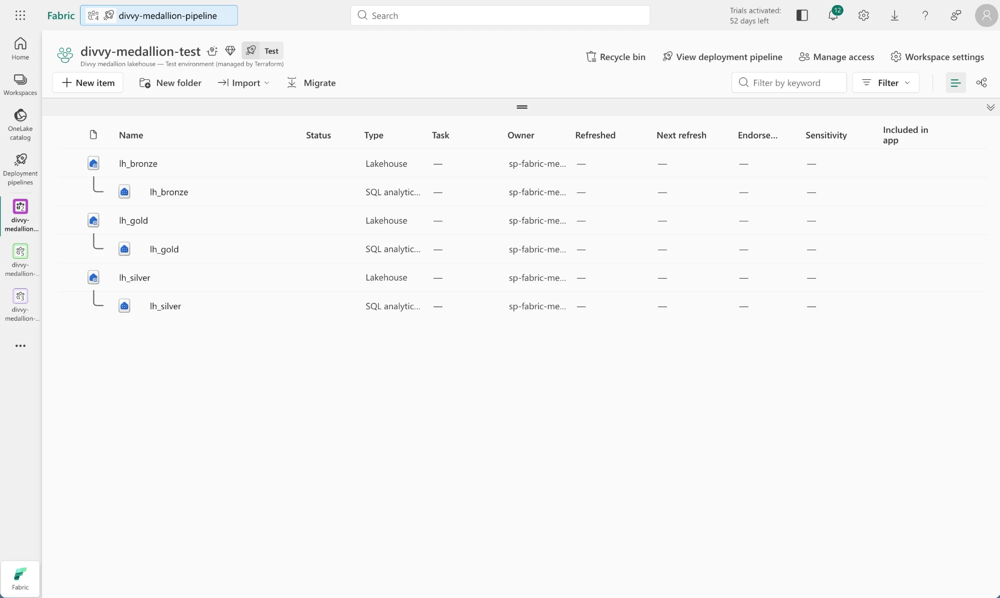
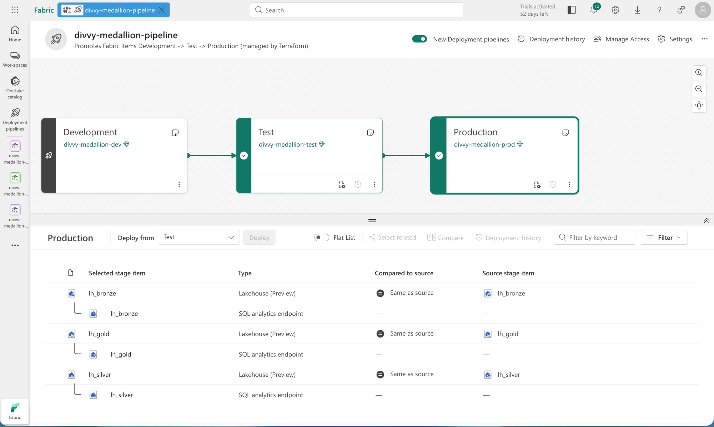
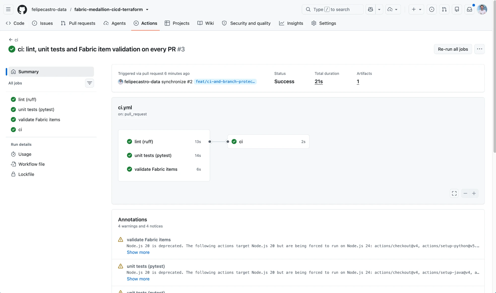
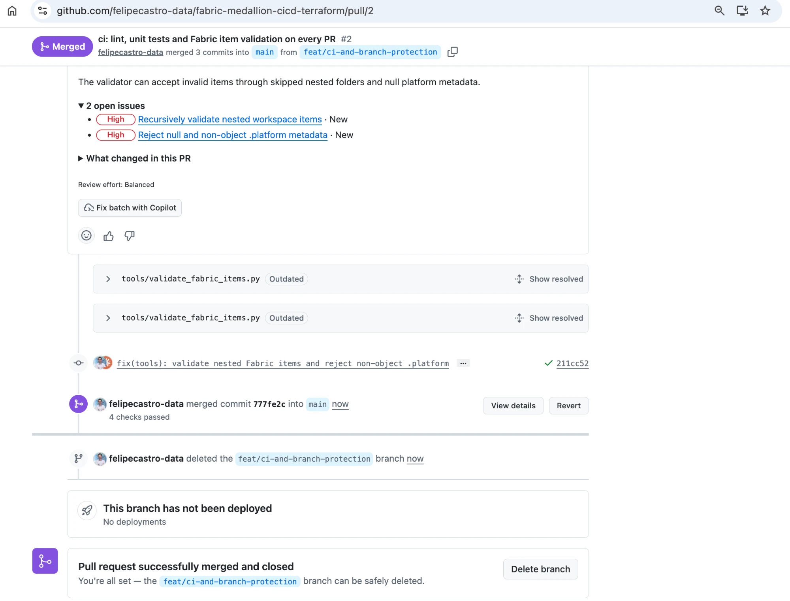
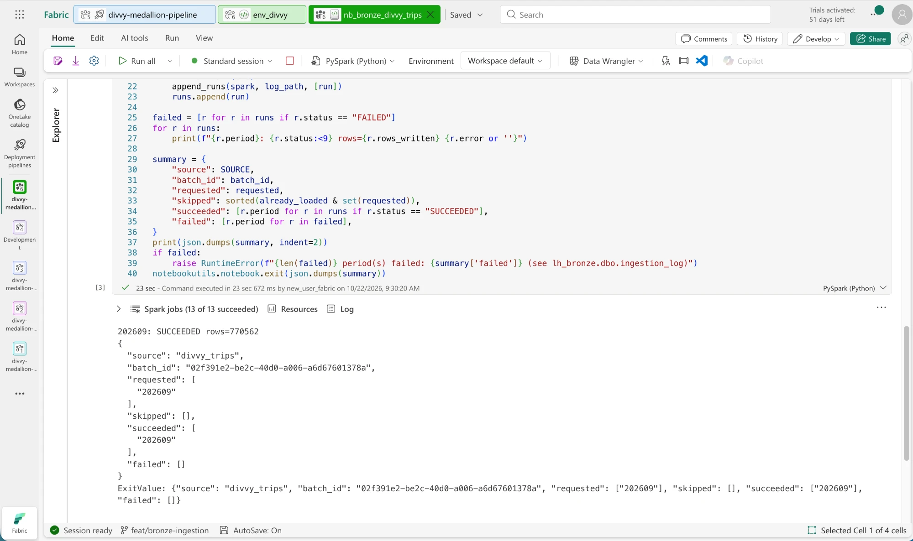
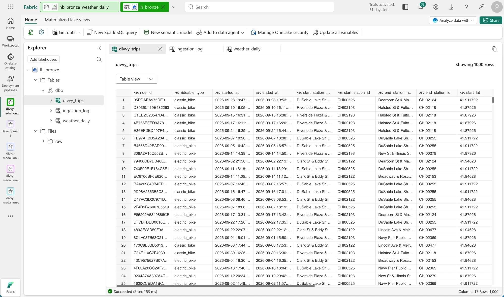
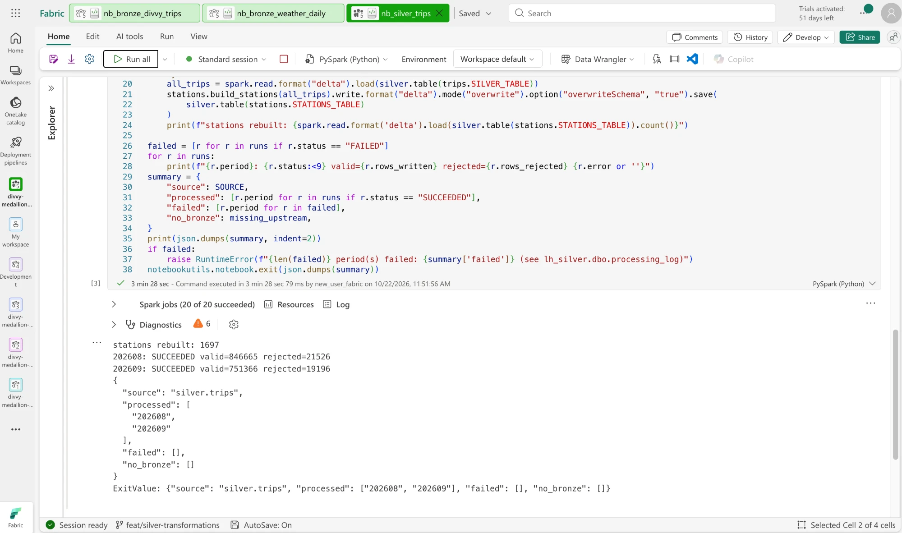

# Fabric Medallion Lakehouse — Terraform · CI/CD · Data Quality

> 🚧 **Work in progress** — see [docs/PLAN.md](docs/PLAN.md) for live progress and
> [docs/development-workflow.md](docs/development-workflow.md) for the branching model.

Production-grade data engineering project on **Microsoft Fabric**: a bronze / silver / gold lakehouse built on
real Chicago **Divvy** bike-share trips enriched with **Open-Meteo** weather, provisioned with **Terraform**,
promoted Dev → Test → Prod through **GitHub Actions** and **Fabric Deployment Pipelines**, and guarded by
**PySpark unit tests** and **data-quality checks**.

## Architecture




## Tech stack

| Area | Tools |
|------|-------|
| Platform | Microsoft Fabric (Lakehouse, Notebooks, Data Pipelines, Environments) |
| Processing | PySpark 3.5 / Delta Lake |
| Infrastructure as Code | Terraform (`microsoft/fabric` provider), HCP Terraform remote state |
| CI/CD | GitHub Actions (OIDC, no secrets), Fabric Git integration, Fabric Deployment Pipelines |
| Testing | pytest, chispa, rules-based data-quality framework |

## Screenshots

### Infrastructure as Code

| Terraform plan posted on every pull request | Apply gated by a manual approval |
|---|---|
|  |  |

| Workspaces and lakehouses created by the CI service principal | Deployment pipeline with lakehouses paired across stages |
|---|---|
|  |  |

### Quality gates

| `ci` runs on every pull request (required to merge) | Review findings must be fixed and resolved before `main` accepts the merge |
|---|---|
|  |  |

### Bronze layer

| Idempotent monthly ingestion (770,562 trips = source row count) | Bronze tables + ingestion log in `lh_bronze` |
|---|---|
|  |  |

### Silver layer

`nb_silver_trips` types, validates and deduplicates every Bronze period. Failing rows are **quarantined with reason codes,
never dropped** — valid + quarantined always equals the Bronze row count:

| Period | Bronze rows | Silver `trips` | `trips_quarantine` |
|---|---:|---:|---:|
| 2026-08 | 868,191 | 846,575 | 21,616 (2.5%) |
| 2026-09 | 770,562 | 751,283 | 19,279 (2.5%) |

Quarantine reasons (both months): `duration_under_60s` 39,521 · `missing_end_coordinates` 1,327 ·
`duration_over_24h` 1,303 · `coordinates_out_of_range` 10 — 1,266 rows fail more than one rule.



### Gold layer & data-quality gate

Star schema in `lh_gold` (`fact_trips`, `dim_date`, `dim_station`, `dim_weather`) plus `agg_daily_kpis` and
`agg_station_monthly`. `nb_dq_checks` runs **45 checks** per run (keys, uniqueness, accepted values, ranges,
referential integrity, Bronze→Silver→Gold→aggregate reconciliation, quarantine rate, freshness), appends them to
`dq_results` and **fails the pipeline on any `error` check**.

The gate earned its keep on real data: Divvy's monthly files overlap at the boundary (the September file holds 43
trips from 31 August), which split one day into two aggregate rows. Aggregates are now keyed by the trip's own month
and an aggregate-grain check blocks any regression:

| Trip month | Trips in `fact_trips` | `agg_daily_kpis` rows | Reconciled |
|---|---:|---:|---|
| 2026-07 (boundary spill-over) | 143 | 2 | ✅ |
| 2026-08 | 846,475 | 62 (31 days × 2 rider types) | ✅ |
| 2026-09 | 751,240 | 60 (30 days × 2 rider types) | ✅ |

## Repository layout

```
.github/workflows/   ci (lint · tests · Fabric item validation), terraform (plan/apply), CD (Dev → Test → Prod)
infra/terraform/     Workspaces, lakehouses, environments, role assignments, deployment pipeline
fabric/              Fabric items synced through Git integration
src/divvy_medallion/ PySpark transformations and data-quality rules (built as a wheel)
tests/               Unit tests and data-quality tests
tools/               Repo tooling (Fabric item validator used in CI)
docs/                Plan, architecture and screenshots
```

## License

[MIT](LICENSE)
