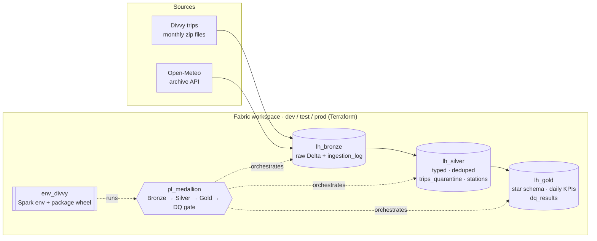
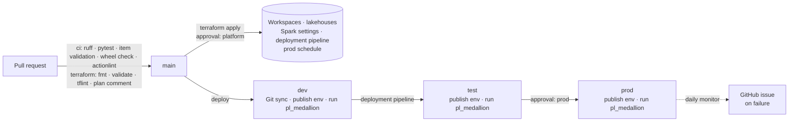
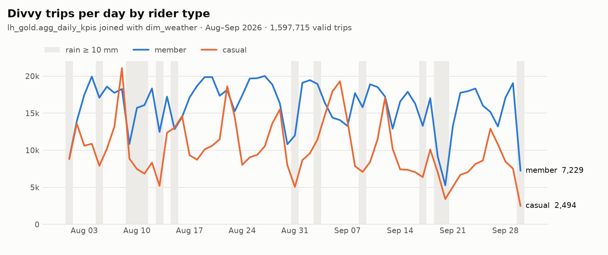
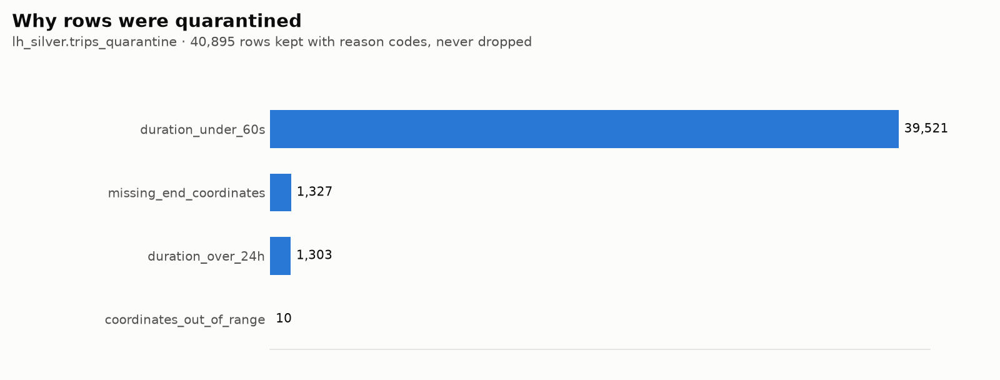
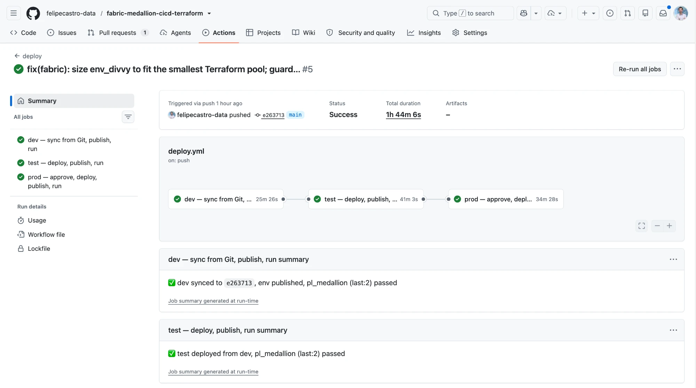
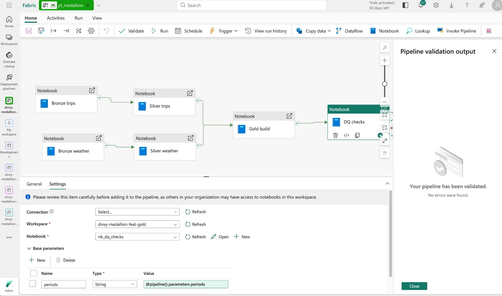

# Fabric Medallion Lakehouse — Terraform · CI/CD · Data Quality

[](https://github.com/felipecastro-data/fabric-medallion-cicd-terraform/actions/workflows/ci.yml)
[](https://github.com/felipecastro-data/fabric-medallion-cicd-terraform/actions/workflows/deploy.yml)
[](https://github.com/felipecastro-data/fabric-medallion-cicd-terraform/actions/workflows/terraform.yml)
[](https://github.com/felipecastro-data/fabric-medallion-cicd-terraform/actions/workflows/monitor.yml)
[](LICENSE)

A production-grade data platform on **Microsoft Fabric**, built the way a platform team would run it: a
bronze / silver / gold lakehouse on real Chicago **Divvy** bike-share trips enriched with **Open-Meteo** weather,
**provisioned with Terraform**, **promoted dev → test → prod by GitHub Actions and Fabric deployment pipelines**, and
**guarded by tests and a data-quality gate at every step**. No secrets anywhere — every automated call uses GitHub
OIDC federated with an Entra service principal.

| At a glance | |
|---|---|
| Environments | 3 Fabric workspaces (dev / test / prod), each with `lh_bronze` · `lh_silver` · `lh_gold` — all Terraform |
| Data | ~2.5M raw trips, **1.6M valid trips** in prod, daily weather, 1,700 stations; every rejected row kept with reason codes |
| Quality | **117 unit tests** (local Spark + Delta) · **45 data-quality checks** per pipeline run · pipeline fails on any `error` check |
| Delivery | 12 reviewed pull requests · CD on every merge (dev → test → **prod with approval**) · weekly prod schedule · daily health monitor |

## Architecture





## What makes it production-grade

- **Infrastructure as code** — workspaces, lakehouses, Spark compute, role assignments, the deployment pipeline and the
  prod schedule are Terraform (`microsoft/fabric`), with remote state in HCP Terraform, a plan comment on every PR and
  an approval-gated apply.
- **Tested transformation code** — all logic lives in the `divvy_medallion` package (`src/`), tested with local Spark +
  Delta; notebooks are thin wrappers. The wheel ships *inside* the Fabric environment in Git, and CI proves it was built
  from the committed source (byte-reproducible builds).
- **Incremental and idempotent everywhere** — partitions are replaced, never appended twice; every layer tracks which
  upstream batch it processed (watermarks), so re-runs are no-ops and a failed step is repaired by a plain retry.
  Breaking schema changes go through an explicit, logged `rebuild=True`.
- **Nothing is silently dropped** — Silver quarantines failing rows with reason codes; Bronze = Silver + quarantine,
  row for row, checked on every run.
- **Data-quality gate** — 45 checks (keys, uniqueness, accepted values, ranges, referential integrity, reconciliation
  across all layers, quarantine rate, freshness) written to `dq_results`; any `error` check fails the pipeline and stops
  promotion.
- **Safe delivery** — `main` is protected (PR, green checks, resolved review threads); CD deploys only the commit it
  built, publishes the environment (Fabric only *stages* it), runs the full pipeline per stage, and waits for a human
  before prod.
- **Operability** — weekly prod schedule, daily health monitor that opens and closes GitHub issues, run logs per layer.

## What the gates caught

Every one of these was found by a test, a check, a failed stage or a review before it could reach production.

| Found by | Problem | Fix |
|---|---|---|
| Data-quality checks on real data | Divvy's monthly files overlap at the boundary (the September file holds 43 trips from 31 August), splitting a day into two aggregate rows | Aggregates keyed by the trip's own month, rebuilt from both files; aggregate-grain checks |
| Reconciliation review | Superseded duplicate rides would have vanished between the Bronze and Silver counts | Superseded versions are quarantined as `duplicate_ride_id` |
| Boundary tests | Second-precision durations let 59.9 s "false starts" through | Millisecond-precision durations; 173 trips correctly re-quarantined |
| Deploy to test (prod skipped) | The Spark environment claimed 80 cores on a 16-core pool — dev had only passed because of portal drift | Right-sized environment; CI test that it fits the smallest Terraform pool |
| Terraform apply | Starter pools with executors = nodes are accepted on create but rejected on update | `max_executors = nodes - 1`, with a guard test |
| Code review | CD could have promoted a newer commit than the one approved; CI tokens could expire mid-run | Deploys pinned to `GITHUB_SHA`; fresh OIDC token per renewal |
| actionlint (added after) | A workflow file that GitHub could not parse | Workflow linting in the required `ci` gate |

## Results (production)



Joining weather into Gold explains the dips: the sharpest drops line up with days of 10 mm+ rain.



| Period | Bronze rows | Silver `trips` | `trips_quarantine` | Gold `fact_trips` |
|---|---:|---:|---:|---:|
| 2026-08 | 868,191 | 846,575 | 21,616 (2.5%) | 846,575 |
| 2026-09 | 770,562 | 751,283 | 19,279 (2.5%) | 751,283 |

Charts are generated from the prod lakehouse with [`tools/ops_charts.py`](tools/ops_charts.py).

## Screenshots

### Continuous deployment and orchestration





### Infrastructure as code

| Terraform plan posted on every pull request | Apply gated by a manual approval |
|---|---|
|  |  |

| Workspaces and lakehouses created by the CI service principal | Deployment pipeline with lakehouses paired across stages |
|---|---|
|  |  |

### Quality gates

| `ci` runs on every pull request (required to merge) | Review findings must be fixed and resolved before `main` accepts the merge |
|---|---|
|  |  |

### Layers

| Bronze: idempotent monthly ingestion (770,562 trips = source rows) | Bronze tables + ingestion log |
|---|---|
|  |  |


## Tech stack

| Area | Tools |
|---|---|
| Platform | Microsoft Fabric — Lakehouse, Notebooks, Data Pipelines, Environments, Deployment Pipelines, Git integration |
| Processing | PySpark 3.5 / Delta Lake (Fabric Runtime 1.3), Python 3.11 package built with hatchling + uv |
| Infrastructure as code | Terraform `microsoft/fabric`, HCP Terraform remote state, tflint |
| CI/CD | GitHub Actions, OIDC → Entra service principal (no secrets), environments with required reviewers, actionlint |
| Testing & quality | pytest, chispa, local Spark + Delta, rules-based data-quality suite, delta-rs for verification over OneLake |

## Repository layout

```
.github/workflows/   ci · terraform (plan/apply) · deploy (dev → test → prod) · monitor (daily health)
infra/terraform/     Workspaces, lakehouses, Spark settings, roles, deployment pipeline, prod schedule
fabric/              Fabric items in Git: lakehouses, env_divvy (with the package wheel), notebooks, pl_medallion
src/divvy_medallion/ Bronze / Silver / Gold transformations, watermarks, data-quality rules and suite
tests/               Unit tests (Spark + Delta), data-quality suite tests, CD tooling tests
tools/               Fabric API CLI, environment publish, wheel sync, item validator, prod monitor, charts
docs/                Plan, development workflow, screenshots, charts
```

## Run it yourself

You need a Fabric capacity (a trial works), an Entra app registration with GitHub OIDC federated credentials, and an
HCP Terraform organization. Then:

1. Set the repository variables (`AZURE_CLIENT_ID`, `AZURE_TENANT_ID`, `FABRIC_CAPACITY_ID`, …) and the
   `TF_API_TOKEN` secret, and create the `platform`, `dev`, `test` and `prod` GitHub environments.
2. Run the `terraform` workflow (apply with `prod_schedule_enabled = false` the first time) to create the workspaces,
   lakehouses and deployment pipeline.
3. Connect the dev workspace to this repository's `fabric/` folder, then run the `deploy` workflow.
4. Re-apply Terraform with `prod_schedule_enabled = true`.

The working conventions for contributors (and AI assistants) are in [CLAUDE.md](CLAUDE.md) and
[docs/development-workflow.md](docs/development-workflow.md).

## 🏅 Author & Certifications

**Felipe Castro**
Senior Data Engineer @ EPAM Systems

- 🏅 **[DP-700: Microsoft Certified: Fabric Data Engineer Associate](https://learn.microsoft.com/api/credentials/share/en-us/FelipeCastro-8026/96572499DF943EBC?sharingId=13D660F56C1DFFA3)**
- 🏅 **[DP-600: Microsoft Certified: Fabric Analytics Engineer Associate](https://learn.microsoft.com/api/credentials/share/en-us/FelipeCastro-8026/6C5A2F5A8A5864FC?sharingId=13D660F56C1DFFA3)**
- 🏅 **[PL-300: Microsoft Certified: Power BI Data Analyst Associate](https://learn.microsoft.com/api/credentials/share/en-us/FelipeCastro-8026/F853AABE365874B3?sharingId=13D660F56C1DFFA3)**

---

## 🚀 Tools & Tech


---

## License

[MIT](LICENSE)
