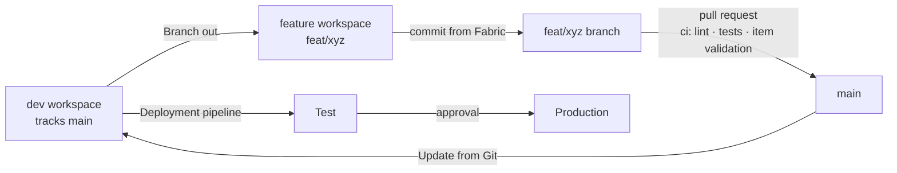

# Development workflow

`main` is protected: every change arrives through a squash-merged pull request with a green `ci` check.
The `divvy-medallion-dev` workspace tracks `main` and is never edited directly.

## Fabric items (notebooks, pipelines, environments)

1. In **divvy-medallion-dev → Source control → Branch out**: new branch `feat/<topic>`, new workspace
   `divvy-medallion-feat-<topic>` on the same capacity.
2. Build and test in the feature workspace; **commit** from Fabric to the feature branch.
3. Open a pull request on GitHub. `ci` validates item naming, `logicalId`s and JSON; reviewers see the item diff.
4. Squash-merge. `divvy-medallion-dev` is updated from Git (Source control → Updates; automated by the CD workflow).
5. The deployment pipeline promotes Development → Test → Production.
6. Delete the feature workspace and branch.

## Code (Python package, tests, Terraform, workflows)

1. `git switch -c feat/<topic>`, make the change, run `uv run ruff check . && uv run pytest`.
   If `src/` changed, bump the version in `pyproject.toml` and run `python tools/sync_environment_wheel.py` —
   the wheel lives inside `fabric/env_divvy.Environment` so every workspace gets the exact library;
   CI (`environment wheel up to date`) fails if the committed wheel was not built from the committed source.
2. Push and open a pull request. `ci` runs on every PR; `terraform` adds a plan comment when `infra/` changes.
3. Squash-merge. Terraform changes are applied after manual approval on the `platform` environment.

## Branch protection (`protect-main` ruleset)

| Rule | Setting |
|------|---------|
| Pull request required | yes (squash merge only, conversations must be resolved) |
| Required status check | `ci` (branch must be up to date) |
| Force push / deletion | blocked |
| Linear history | required |
| Bypass | none |
